

  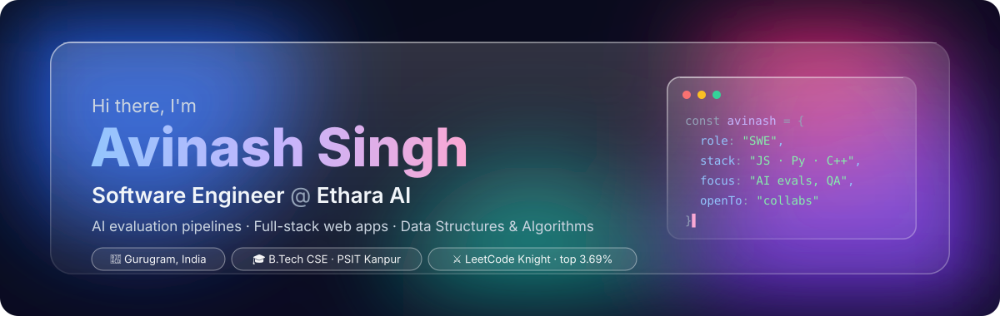

  
  
  
  
  
  

I'm a **Software Engineer at Ethara AI**, where I build **multimodal AI evaluation pipelines**: benchmark datasets, validation frameworks and automated tests that show how well ML models really perform. Before that I did freelance **QA** at InstaWork.

I also build **full-stack web apps**, mainly with **Node.js, Express, MongoDB, Python and Flask**. I enjoy **Data Structures & Algorithms**, and I'm a **LeetCode Knight (top 3.69%)**.

- 🔭 Currently working on **AI model evaluation & quality assurance** at Ethara AI
- 🌱 Exploring **LLM benchmarking**, testing automation and scalable backends
- 🎓 **B.Tech in Computer Science**, Pranveer Singh Institute of Technology, Kanpur (2022–2026, CGPA 8.1)
- 🤝 Open to collaborating on impactful open-source and full-stack projects

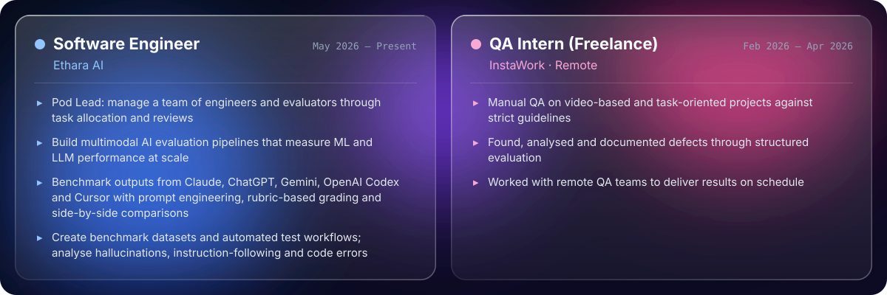

<table>
<tr>
<td width="50%"><a href="https://github.com/Avinash-Singh-13/smart-self-checkout">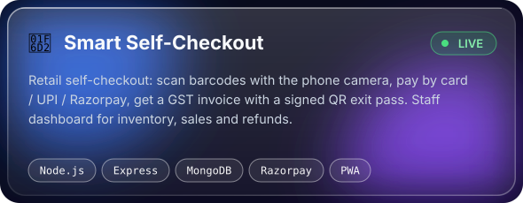</a>

<a href="https://smart-self-checkout.onrender.com">🌐 Live demo</a> · <a href="https://github.com/Avinash-Singh-13/smart-self-checkout">💻 Code</a>
</td>
<td width="50%"><a href="https://github.com/Avinash-Singh-13/ai-mock-interview-platform">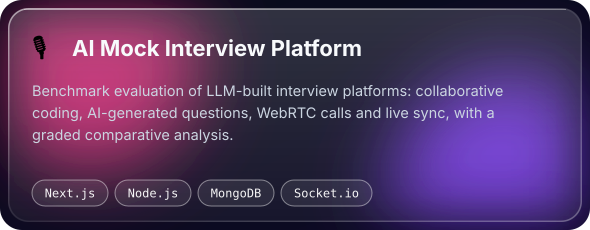</a>

<a href="https://github.com/Avinash-Singh-13/ai-mock-interview-platform">💻 Code</a>
</td>
</tr>
<tr>
<td width="50%"><a href="https://github.com/Avinash-Singh-13/finboard-dashboard">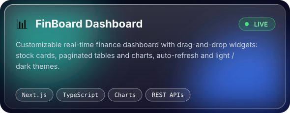</a>

<a href="https://finboard-dashboard-two.vercel.app">🌐 Live demo</a> · <a href="https://github.com/Avinash-Singh-13/finboard-dashboard">💻 Code</a>
</td>
<td width="50%"><a href="https://github.com/Avinash-Singh-13/earthquake-visualizer">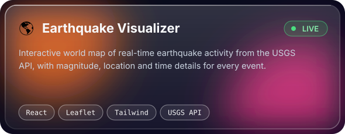</a>

<a href="https://earthquake-visualizer-amber.vercel.app">🌐 Live demo</a> · <a href="https://github.com/Avinash-Singh-13/earthquake-visualizer">💻 Code</a>
</td>
</tr>
<tr>
<td width="50%"><a href="https://github.com/Avinash-Singh-13/team-task-manager">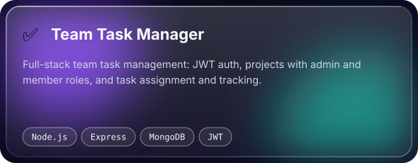</a>

<a href="https://github.com/Avinash-Singh-13/team-task-manager">💻 Code</a>
</td>
<td width="50%"><a href="https://github.com/Avinash-Singh-13/Weather-Forecast-System">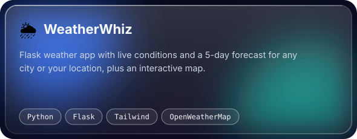</a>

<a href="https://github.com/Avinash-Singh-13/Weather-Forecast-System">💻 Code</a>
</td>
</tr>
<tr>
<td width="50%"><a href="https://github.com/Avinash-Singh-13/E-Commerce-Website-with-Live-AI-Recommendations">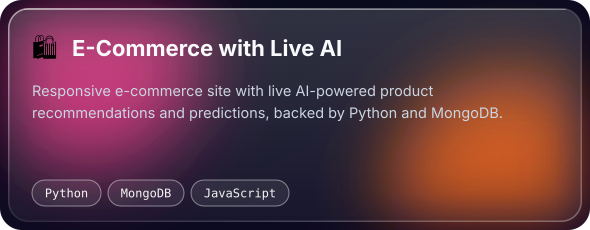</a>

<a href="https://github.com/Avinash-Singh-13/E-Commerce-Website-with-Live-AI-Recommendations">💻 Code</a>
</td>
<td width="50%"><a href="https://github.com/Avinash-Singh-13/Handwritten-word-recognition">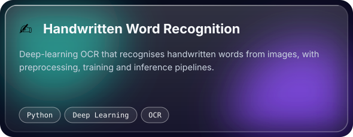</a>

<a href="https://github.com/Avinash-Singh-13/Handwritten-word-recognition">💻 Code</a>
</td>
</tr>
</table>

  
   
  
   
  

  <b>AI / ML & Testing:</b> Machine Learning · Model Evaluation · Benchmark Datasets · Automated &amp; Manual Testing · QA · Bug Reporting 
  <b>Core:</b> Data Structures &amp; Algorithms · OOP · REST APIs

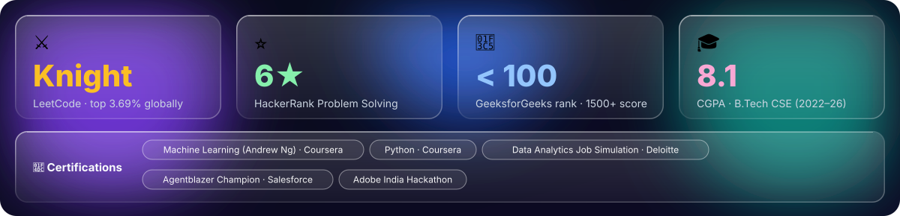

<a href="https://drive.google.com/drive/folders/137sd7wwxKWyDaar_IH_qdgkqboHlmH6e?usp=sharing">📂 View all certificates</a>

  
  

  

  I'm always up for a chat about <b>AI evaluation</b>, <b>full-stack development</b> or <b>DSA</b>. 
  The quickest way to reach me is <a href="https://www.linkedin.com/in/avinash-singh-6b2a362a5">LinkedIn</a> or <a href="mailto:singhavinash7860@gmail.com">email</a>.

  

